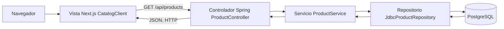
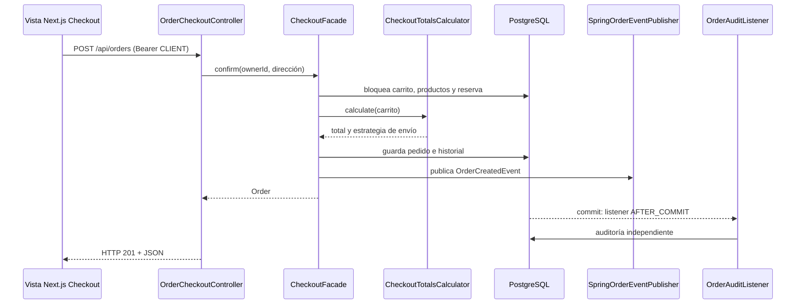

# BKL-065 — Evidencia de Modelo–Vista–Controlador (MVC)

Este documento identifica **clases reales** de TechStore y cómo se materializa
MVC en una aplicación con **Vista Next.js** y **Controladores Spring REST**
(arquitectura monolítica modular en API, no MVC clásico de páginas servidor).

## Responsabilidades y trazabilidad

| Capa | Código real | Responsabilidad |
| --- | --- | --- |
| Vista | `apps/web/src/app/productos/CatalogClient.tsx`, `productos/[id]/ProductDetailClient.tsx` | Formularios, estados, navegación, mensajes y renderizado; no SQL ni decisiones de autorización |
| Vista | `apps/web/src/app/pedidos/OrdersClient.tsx` | Historial y detalle mediante API autenticada; token en memoria |
| Controlador | `catalog/controller/ProductController.java` | Rutas públicas `GET /api/products` y `/{id}`; valida/normaliza vía servicio |
| Controlador | `orders/controller/OrderCheckoutController.java` | `POST /api/orders`, autentica cliente, transforma respuesta HTTP; delega a fachada |
| Modelo / servicio | `catalog/service/ProductService.java` | Reglas de filtros, rango de precios, búsqueda y paginación |
| Modelo / servicio | `orders/service/CheckoutFacade.java` | Transacción del checkout, validación stock, cálculo total, reserva y creación de pedido |
| Modelo / dominio | `catalog/domain/Product.java`, `cart/domain/CartLine.java`, `orders/domain/Order.java` | Estructuras del negocio independientes de HTML |
| Modelo / persistencia | `catalog/repository/JdbcProductRepository.java`, `orders/repository/JdbcOrderRepository.java` | SQL parametrizado y PostgreSQL, nunca desde la Vista |

> El patrón arquitectónico MVC no reemplaza los GoF: `CheckoutTotalsCalculator`
> utiliza `ShippingStrategy` (**Strategy**), `CheckoutFacade` encapsula
> confirmación (**Facade**) y `OrderAuditListener` observa eventos
> `AFTER_COMMIT` (**Observer**).

## Diagrama de componentes MVC

## Secuencia de un pedido con GoF

## Procedimiento de demostración reproducible

1. Arrancar PostgreSQL: `docker compose -f infrastructure/compose.yaml up -d`.
2. Configurar `SPRING_DATASOURCE_PASSWORD` localmente, arrancar API con
   `npm run dev:api` y Next.js con `npm run dev:web`.
3. En el navegador abrir `http://localhost:3000/productos`, inspeccionar
   **Network** y confirmar `GET http://localhost:8080/api/products?page=0&size=12`.
4. Mostrar el cuerpo JSON (sin secretos) y señalar el método
   `ProductController.listProducts`, `ProductService.searchActiveProducts`
   y `JdbcProductRepository.findActivePage`.
5. Registrar/iniciar sesión CLIENT, agregar al carrito y confirmar checkout
   en sandbox; mostrar `OrderCheckoutController.create` y la operación
   `CheckoutFacade.confirm`. **PENDING** no equivale a pago confirmado.
6. Para evidencia de pruebas ejecutar `npm run lint:web`,
   `npm run typecheck:web`, `npm run test:api` y
   `mvn -B -ntp -f apps/api/pom.xml verify` con base de pruebas aislada.

### Responsabilidades y principios de diseño

- **Cohesión:** vistas rinden UI, controladores traducen protocolos,
  servicios implementan casos de uso, repositorios persisten.
- **Bajo acoplamiento:** Controller depende de servicios/puertos; la Vista
  desconoce tablas y el SQL no depende de componentes React.
- **Defensivo:** identidad de usuario viene de `SessionPrincipal`,
  totales/stock se validan en el servidor y el frontend solo anticipa errores.
- **Testabilidad:** pruebas de controlador/HTTP, lógica de negocio y
  auditoría post-commit se ejecutan independientemente.

## Límite de la evidencia

Los archivos y comandos describen un recorrido **reproducible**;
la grabación, capturas y ensayo efectivo con operador son actividades
manuales de BKL-071. La documentación no representa una demo ejecutada.
